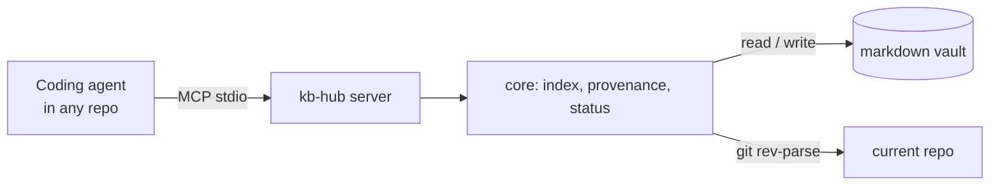

# kb-hub

> Works on macOS and Windows (Linux too).
>
> Your notes, bug history and private specs, available to your coding agent in any repo, with a record of where each note came from.

**Status: in progress.** v0.1 is being built spec-first with [OpenSpec](https://github.com/Fission-AI/OpenSpec). Follow the plan in [`openspec/changes/`](openspec/changes/).

## Why

Coding agents can't see what you know: notes, bug context, decisions, and specs that can't go into a big shared repo. So every session starts with you searching and pasting context by hand, and what you learn during the session is lost when it ends.

kb-hub keeps that knowledge in a plain markdown vault (the LLM Wiki pattern described by Andrej Karpathy) and serves it to any agent through MCP. The agent does the synthesis; kb-hub keeps the books.

## What v0.1 does

| Tool | What it does |
| --- | --- |
| `ping` | Confirms the agent is connected and shows which vault it sees |
| `search` | Full-text search over the vault, wiki pages ranked above raw captures |
| `read` | Reads a page with its frontmatter, never outside the vault |
| `capture` | Saves a note to `raw/inbox/` stamped with repo, branch, commit and work item ID |
| `status` | Captures not yet compiled into the wiki, broken `[[wikilinks]]`, latest log entries |

Example, against the [example vault](examples/demo-vault):

```text
search { "query": "coupon", "limit": 2 }

1. Incident 2026-10: coupon applied twice (wiki/incident-2026-10-coupon-applied-twice.md, wiki)
   Incident 2026-10: coupon applied twice What happened. On 21 October, customers who retried a failed payment got their coupon discount applied a second time…
2. Coupon applied twice on retry (raw/inbox/2026-10-21-coupon-applied-twice-on-retry.md, raw)
   Customers who retry a failed payment get the coupon discount twice…
```

The compiled wiki page comes first; the raw capture it was built from comes second. `read { "path": "wiki/incident-2026-10-coupon-applied-twice.md" }` then returns the page's frontmatter and body.

While working on branch `feature/4821-checkout`, the agent saves what it learned:

```text
capture { "title": "Expired coupon breaks checkout", "text": "Coupons past their end date throw instead of being ignored." }

Captured "Expired coupon breaks checkout" to raw/inbox/2026-11-09-expired-coupon-breaks-checkout.md
from mate-and-co/storefront on feature/4821-checkout at 9f3c2ab (work item 4821).
```

And `status` shows what still needs work, without spending a token:

```text
**Vault:** 3 wiki pages, 1 project pages, 3 raw captures.

**Pending captures (1):**
- raw/inbox/2026-11-08-shipping-cost-rounding.md: Shipping cost rounding differs between cart and checkout (2026-11-08)

**Broken links (1):**
- [[refund-policy]] in wiki/checkout-flow.md
```

Plus `npx kb-hub init <dir>` to create a vault with an `AGENTS.md` that tells the agent how to use it.

## Quickstart

Not on npm yet. Until the v0.1.0 release, run it from source:

```bash
git clone https://github.com/jMautone/kb-hub && cd kb-hub && npm ci && npm run build
node dist/cli.js init ~/my-vault
claude mcp add kb -- node "$PWD/dist/cli.js" mcp --vault ~/my-vault
```

On Windows (PowerShell), use `$env:USERPROFILE\my-vault` instead of `~/my-vault`.

Once published, it will be:

```bash
npx kb-hub init ~/my-vault
claude mcp add kb -- npx -y kb-hub mcp --vault ~/my-vault
# Windows: claude mcp add kb -- cmd /c npx -y kb-hub mcp --vault %USERPROFILE%\my-vault
```

Then ask the agent, in any repo, to `ping` kb-hub to confirm it sees your vault. To try it without your own notes, point `--vault` at [`examples/demo-vault`](examples/demo-vault), a made-up knowledge base for a fictional online store.

## How it works

A demo recording script lives in [`demo/demo.tape`](demo/demo.tape) (render it with [VHS](https://github.com/charmbracelet/vhs)).



## Make the agent use it

The vault's own `AGENTS.md` tells an agent how to search, capture and compile. To make Claude Code reach for the vault from **any** repo, add this to your user-level `~/.claude/CLAUDE.md` (Windows: `%USERPROFILE%\.claude\CLAUDE.md`):

```markdown
## Knowledge vault (kb-hub)
- Before asking me for context about a bug, feature, work item or business term, `search` the kb vault and `read` the relevant pages.
- When we find a root cause, make a decision, or I explain something not written anywhere, `capture` it in one short note.
- Never capture secrets or credentials.
```

**Compiling** captures into wiki pages is the agent's job, not kb-hub's. Open a session in the vault folder (`cd ~/my-vault && claude`) and ask it to compile pending captures; it follows the vault's `AGENTS.md` and records each capture in the page's `sources`, which is how `status` knows it is done.

## Provenance

`capture` reads provenance with `git` from the folder the MCP server runs in. Claude Code starts stdio servers in the project folder, so in practice that is the repo you are working on. If your client starts it somewhere else, the agent can pass `cwd` with the repo path. Outside a repo, or without git installed, the note is still saved with empty provenance.

| Field | Where it comes from |
| --- | --- |
| `repo` | The `origin` remote as `owner/name`, or `org/project/name` for Azure DevOps. Credentials in the URL are dropped. Without `origin`, the repo folder name. |
| `branch` | Current branch, `null` in detached HEAD. |
| `commit` | Short hash of `HEAD`. |
| `work_item` | First number of 2+ digits that starts the branch name or follows a `/` (`feature/4821-checkout` → `4821`). Set `KB_WORKITEM_PATTERN` to a regex with one capture group for other conventions, e.g. `AB#(\d+)` or `(PROJ-\d+)`. |

On Windows, provenance needs [Git for Windows](https://git-scm.com/download/win) on the `PATH`.

## Alternatives

| Tool | Use it instead when |
| --- | --- |
| [llm-wiki-mcp](https://github.com/flsteven87/llm-wiki-mcp) | You want the LLM Wiki pattern in Python with write-page and inventory tools, and don't need provenance or link checks |
| Basic Memory, qmd | You want semantic search over notes and don't need the LLM Wiki structure |

## Roadmap

- **v0.2:** serve specs that can't live in a shared repo from the vault (`kb link`), plus skills to ingest, query and review.
- **v0.3:** terminal CLI (`kb add`, `kb push`), stale-page and drift checks, export to Azure DevOps Wiki.

## License

[MIT](LICENSE)
