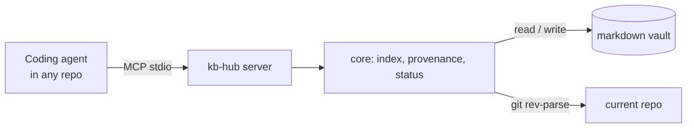

# kb-hub

> Works on macOS and Windows (Linux too).
>
> Your notes, bug history and private specs, available to your coding agent in any repo, with a record of where each note came from.


**Status: v0.1 is feature-complete and not on npm yet.** It was built spec-first with [OpenSpec](https://github.com/Fission-AI/OpenSpec): the behavior contract is in [`openspec/specs/`](openspec/specs/) and the history of each change in [`openspec/changes/archive/`](openspec/changes/archive/).

## Why

Coding agents can't see what you know: notes, bug context, decisions, and specs that can't go into a big shared repo. So every session starts with you searching and pasting context by hand, and what you learn during the session is lost when it ends.

kb-hub keeps that knowledge in a plain markdown vault (the LLM Wiki pattern described by Andrej Karpathy) and serves it to any agent through MCP. The agent does the synthesis; kb-hub keeps the books.

## What v0.1 does

| Tool | What it does |
| --- | --- |
| `ping` | Confirms the agent is connected and shows which vault it sees |
| `search` | Full-text search over the vault, wiki pages ranked above raw captures |
| `read` | Reads a page with its frontmatter, never outside the vault |
| `capture` | Saves a note to `raw/inbox/` stamped with repo, branch, commit and work item ID |
| `status` | Captures not yet compiled into the wiki, broken `[[wikilinks]]`, latest log entries |

Example, against the [example vault](examples/demo-vault):

```text
search { "query": "coupon", "limit": 2 }

1. Incident 2026-10: coupon applied twice (wiki/incident-2026-10-coupon-applied-twice.md, wiki)
   Incident 2026-10: coupon applied twice What happened. On 21 October, customers who retried a failed payment got their coupon discount applied a second time…
2. Coupon applied twice on retry (raw/inbox/2026-10-21-coupon-applied-twice-on-retry.md, raw)
   Customers who retry a failed payment get the coupon discount twice…
```

The compiled wiki page comes first; the raw capture it was built from comes second. `read { "path": "wiki/incident-2026-10-coupon-applied-twice.md" }` then returns the page's frontmatter and body.

From a repo on branch `feature/4821-checkout`, the agent saves what it learned:

```text
capture { "title": "Checkout fails with expired coupon", "text": "The cart checks coupon expiry, checkout does not. Validate again on POST /checkout." }

Captured raw/inbox/2026-11-10-checkout-fails-with-expired-coupon.md ("Checkout fails with expired coupon"). Provenance: repo mate-and-co/storefront, branch feature/4821-checkout, commit 5d8bcb0, work item 4821.
```

The note lands in the inbox with its provenance in the frontmatter, and `log.md` gets a `capture` entry:

```yaml
---
title: Checkout fails with expired coupon
tags: []
captured_at: "2026-11-10T09:14:02-03:00"
provenance:
  repo: mate-and-co/storefront
  branch: feature/4821-checkout
  commit: "5d8bcb0"
  work_item: "4821"
---
```

`status` then shows what still needs work, computed without a model:

```text
**Vault:** 3 wiki pages, 1 project page, 4 raw notes.

**Pending captures (2):** not yet compiled into a wiki or project page.
- 2026-11-08 · Shipping cost rounding differs between cart and checkout · `raw/inbox/2026-11-08-shipping-cost-rounding.md`
- 2026-11-10 · Checkout fails with expired coupon · `raw/inbox/2026-11-10-checkout-fails-with-expired-coupon.md`

To compile them, follow "Compiling" in the vault's AGENTS.md.

**Broken links (1):**
- `[[refund-policy]]` in `wiki/checkout-flow.md`

**Recent log:**
- [2026-11-10] capture | Checkout fails with expired coupon
- [2026-11-08] capture | Shipping cost rounding differs between cart and checkout
- [2026-11-04] compile | wiki/checkout-flow.md
- [2026-11-03] capture | Checkout timeout in the payment sandbox
- [2026-10-22] compile | wiki/incident-2026-10-coupon-applied-twice.md
```

A capture counts as compiled once a page in `wiki/` or `projects/` lists it in its `sources` frontmatter. Compiling is the agent's job, in a session opened at the vault, following the vault's `AGENTS.md`.

Plus `npx kb-hub init <dir>` to create a vault with an `AGENTS.md` that tells the agent how to use it.

## Quickstart

Not on npm yet. Until the v0.1.0 release, run it from source:

```bash
git clone https://github.com/jMautone/kb-hub && cd kb-hub && npm ci && npm run build
node dist/cli.js init ~/my-vault
claude mcp add kb --scope user -- node "$PWD/dist/cli.js" mcp --vault ~/my-vault
```

On Windows (PowerShell), use `$env:USERPROFILE\my-vault` instead of `~/my-vault`. `--scope user` makes the server available in every project, not only the folder you ran the command in.

Once published, it will be:

```bash
npx kb-hub init ~/my-vault
claude mcp add kb --scope user -- npx -y kb-hub mcp --vault ~/my-vault
# Windows: claude mcp add kb --scope user -- cmd /c npx -y kb-hub mcp --vault %USERPROFILE%\my-vault
```

Then ask the agent, in any repo, to `ping` kb-hub to confirm it sees your vault. To try it without your own notes, point `--vault` at [`examples/demo-vault`](examples/demo-vault), a made-up knowledge base for a fictional online store.

### Make the agent use it

The vault's own `AGENTS.md` tells an agent how to search, capture and compile, but only when the session is opened in the vault. For every other repo, add this to your user-level `~/.claude/CLAUDE.md` (on Windows, `%USERPROFILE%\.claude\CLAUDE.md`):

```markdown
## Knowledge base (kb-hub)

I keep my notes, bug history and decisions in a vault served by the `kb` MCP server.

- Before asking me for context about a bug, feature, work item, business term or past decision, search the vault with `kb` `search` and `read` the most relevant pages. Cite the pages you used.
- When we learn something worth keeping beyond this session (a root cause, a decision and its reason, a command that worked, context I explained), save it with `kb` `capture`: one topic, a short specific title, written so it makes sense without this conversation.
- Never capture secrets, credentials or personal data.
```

## Provenance

Every capture records where it came from, read from git in the folder the agent is working in:

| Field | Source |
| --- | --- |
| `repo` | `owner/name` from the `origin` remote (`org/project/repo` for Azure DevOps), or the repo folder's name when there is no `origin`. Credentials in the URL are never stored. |
| `branch` | The current branch, or `null` in detached HEAD |
| `commit` | The short hash of `HEAD`, or `null` before the first commit |
| `work_item` | The first number of two or more digits at the start of the branch name or after a `/` (`feature/4821-checkout` → `4821`, `bugfix/77-null-cart` → `77`) |

Outside a git repo, or when git is not installed, the note is still saved and every field is `null`. On Windows this needs [Git for Windows](https://git-scm.com/download/win) on `PATH`.

**Other work item formats.** Set `KB_WORKITEM_PATTERN` to a regular expression; its first capture group becomes the work item. For example, for Jira-style branches like `PROJ-123-checkout`:

```bash
claude mcp add kb --scope user -e KB_WORKITEM_PATTERN='([A-Z]+-\d+)' -- npx -y kb-hub mcp --vault ~/my-vault
```

**Which repo?** kb-hub reads git in its own working directory. Claude Code starts MCP servers in the folder where you run `claude`, so captures get that repo's provenance with no extra setup. This was checked with Claude Code 2.1 and a test repo on `feature/4821-checkout` with an Azure DevOps remote: the capture came out with `contoso/Shop/storefront`, the branch, the commit and work item `4821`, without passing `cwd`. If your client starts servers somewhere else, the capture result says that no repository was found, and the agent can pass the repo path as `cwd`. To check your setup, ask the agent to `ping` kb-hub and then make a test capture.

## How it works



## Alternatives

| Tool | Use it instead when |
| --- | --- |
| [llm-wiki-mcp](https://github.com/flsteven87/llm-wiki-mcp) | You want the LLM Wiki pattern in Python with write-page and inventory tools, and don't need provenance or link checks |
| Basic Memory, qmd | You want semantic search over notes and don't need the LLM Wiki structure |

## Development

```bash
npm ci
npm run check        # lint, build and tests: the gate before every PR
npm run dev -- mcp --vault examples/demo-vault
vhs demo/demo.tape   # re-records demo/demo.gif; needs VHS, node, git and jq
```

See [`AGENTS.md`](AGENTS.md) for how changes are made, and [`docs/decisions/`](docs/decisions/) for the decisions behind the design.

## Roadmap

- **v0.2:** serve specs that can't live in a shared repo from the vault (`kb link`), plus skills to ingest, query and review.
- **v0.3:** terminal CLI (`kb add`, `kb push`), stale-page and drift checks, export to Azure DevOps Wiki.

## License

[MIT](LICENSE)
