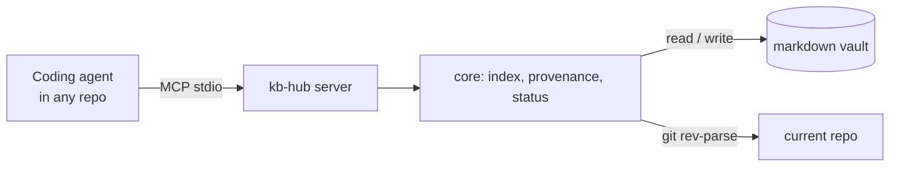

# kb-hub

> Works on macOS and Windows (Linux too).
>
> Your notes, bug history and private specs, available to your coding agent in any repo, with a record of where each note came from.

**Status: in progress.** v0.1 is being built spec-first with [OpenSpec](https://github.com/Fission-AI/OpenSpec). Follow the plan in [`openspec/changes/`](openspec/changes/).

## Why

Coding agents can't see what you know: notes, bug context, decisions, and specs that can't go into a big shared repo. So every session starts with you searching and pasting context by hand, and what you learn during the session is lost when it ends.

kb-hub keeps that knowledge in a plain markdown vault (the LLM Wiki pattern described by Andrej Karpathy) and serves it to any agent through MCP. The agent does the synthesis; kb-hub keeps the books.

## What v0.1 does

| Tool | What it does |
| --- | --- |
| `ping` | Confirms the agent is connected and shows which vault it sees |
| `search` | Full-text search over the vault, wiki pages ranked above raw captures |
| `read` | Reads a page with its frontmatter, never outside the vault |
| `capture` | Saves a note to `raw/inbox/` stamped with repo, branch, commit and work item ID |
| `status` | Captures not yet compiled into the wiki, broken `[[wikilinks]]`, latest log entries |

Plus `npx kb-hub init <dir>` to create a vault with an `AGENTS.md` that tells the agent how to use it.

## Quickstart

Not on npm yet. Until the v0.1.0 release, run it from source:

```bash
git clone https://github.com/jMautone/kb-hub && cd kb-hub && npm ci && npm run build
node dist/cli.js init ~/my-vault
claude mcp add kb -- node "$PWD/dist/cli.js" mcp --vault ~/my-vault
```

On Windows (PowerShell), use `$env:USERPROFILE\my-vault` instead of `~/my-vault`.

Once published, it will be:

```bash
npx kb-hub init ~/my-vault
claude mcp add kb -- npx -y kb-hub mcp --vault ~/my-vault
# Windows: claude mcp add kb -- cmd /c npx -y kb-hub mcp --vault %USERPROFILE%\my-vault
```

Then ask the agent, in any repo, to `ping` kb-hub to confirm it sees your vault. To try it without your own notes, point `--vault` at [`examples/demo-vault`](examples/demo-vault), a made-up knowledge base for a fictional online store.

## How it works



## Alternatives

| Tool | Use it instead when |
| --- | --- |
| [llm-wiki-mcp](https://github.com/flsteven87/llm-wiki-mcp) | You want the LLM Wiki pattern in Python with write-page and inventory tools, and don't need provenance or link checks |
| Basic Memory, qmd | You want semantic search over notes and don't need the LLM Wiki structure |

## Roadmap

- **v0.2:** serve specs that can't live in a shared repo from the vault (`kb link`), plus skills to ingest, query and review.
- **v0.3:** terminal CLI (`kb add`, `kb push`), stale-page and drift checks, export to Azure DevOps Wiki.

## License

[MIT](LICENSE)
